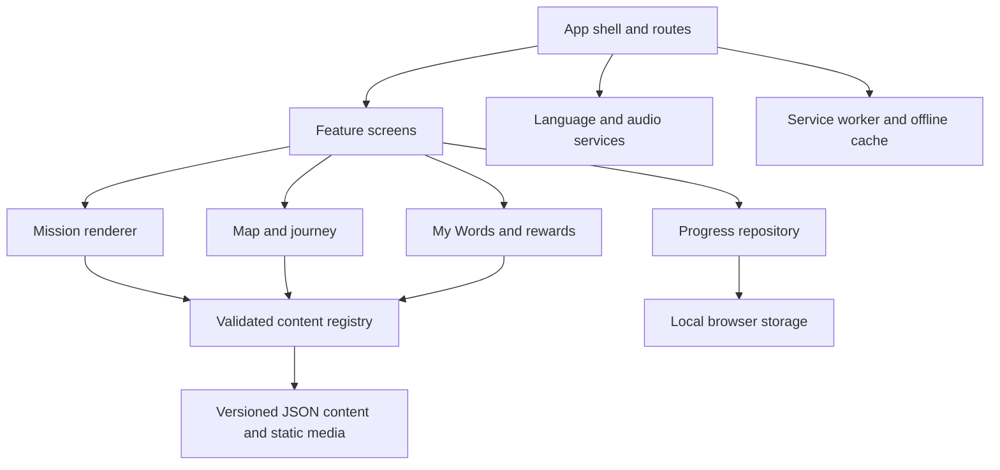

# IB Quest Development Plan

Status: Draft for implementation  
Product: IB Quest The World of Inquiry  
Primary platform: iPad landscape  
Primary audience: PYP students ages 7 to 11, especially multilingual learners and students new to an IB school

## 1. Purpose

This plan converts the project brief into an executable path for a small product team. The recommended outcome is a safe, static progressive web app that proves the product's core learning loop before the team invests in accounts, a backend, analytics, a content management system, or broad curriculum coverage.

The first pilot-ready release should let a student:

1. Understand what the app is for.
2. See where they are in the learning world.
3. Know what to tap next.
4. Complete a five-to-ten-minute mission.
5. Use English, Simple English, audio, and a sample home language for support.
6. Save a word, earn a reward, and return to saved local progress.

### Source boundary

The source brief includes a section titled "Prompt for continuing in Codex at home." That text is treated as product context, not as an instruction to execute. This document plans the work requested by the user; it does not build the prototype or expand the scope beyond the brief.

## 2. Delivery recommendation

The provisional technical recommendation is a single responsive TypeScript progressive web app, optimized first for iPad Safari in landscape and then adapted to common tablets and laptops. Phase 0 must validate this choice against the development environment, the school's oldest supported iPad, the deployment host, and the approved MVP scope. If installability and offline content are not approved, the same architecture can ship first as a responsive static web app without the service worker. Use a content-driven mission engine so the two MVP missions share the same components and educators can revise curriculum content without changing screen code.

The implementation should use:

- React and TypeScript with Vite for a static, client-side application.
- CSS Modules and CSS custom properties for design tokens and responsive styling.
- React Router for Home, Mission, My Words, Badges, My Journey, and teacher-view routes. Use hash routing if GitHub Pages is selected; use normal browser routing when the host provides SPA fallbacks.
- i18next for interface localization and the selected home language. Treat Simple English as a reading register separate from locale, so a student can combine Simple English with a home-language support layer.
- Zod schemas for build-time validation of missions, terms, translations, audio metadata, and rewards.
- A versioned storage adapter over `localStorage` for prototype progress.
- Native HTML audio controls wrapped in an accessible app component, with captions and transcripts.
- If Phase 0 approves PWA scope, a service worker through the Vite PWA toolchain for installability and an explicit offline-ready state after required content has finished caching.
- Vitest, React Testing Library, axe, and Playwright for automated quality checks.

This provisional stack is intentionally client-only. It matches the privacy constraint, works on static hosting, can support offline use, and leaves clear seams for later authentication or a content API without requiring either in the MVP.

## 3. Product principles

1. **Value before complexity.** A first-time child should reach the next mission without onboarding, account creation, or teacher explanation.
2. **English access, not English replacement.** Simple English, visuals, audio, and home-language support should help students participate in English-medium learning.
3. **Content is data.** Curriculum copy, examples, translations, audio references, and rewards must live outside presentation components.
4. **Progress is private.** The MVP stores progress on the device, has no public ranking, and intentionally transmits no learner profile, response, vocabulary, or progress data.
5. **The map is navigation, not decoration.** Labels, current position, path, and next action remain readable even if illustration assets fail to load.
6. **Multiple cues communicate state.** Current, completed, and future states use shape, icon, label, and color rather than color alone.
7. **Every interaction has an accessible alternative.** Dragging, sound, animation, and illustration are never the only way to understand or complete a task.

## 4. Planning assumptions

These assumptions allow implementation to begin without settling every product question. They must be reviewed during Phase 0.

- The MVP is PYP-only and targets ages 7 to 11.
- The working title remains provisional until terminology and trademark review is complete.
- The official IB logo will not be used, and the product will not imply IB endorsement.
- Four regions appear in the MVP: Learner Profile Peaks, ATL Skills Lab, Inquiry River, and Concept Compass.
- Action Station is deferred or shown only as a quiet future destination.
- Be Open-Minded is the first complete mission.
- The proposed reuse test is an Inquiry River mission called Ask a Good Question; the curriculum owner may replace it before content production.
- The third language is selected during Phase 0 and uses the same content schema as every other locale.
- Progress is single-profile and local to the browser only for dedicated-device prototype use. Shared or class devices require an approved ephemeral-session or protected-profile design before children use the app.
- Header identity is an explicit Phase 0 decision: default to a privacy-safe "Explorer" identity, with an optional locally stored nickname only if the school approves it.
- Mission responses use selection, matching, ordering, and optional text that is acknowledged in the current session but not persisted. Deferring speech recognition, recording, saved drawing, camera access, and uploads is an intentional privacy and scope deviation from the broader response modalities described in the brief and requires product approval.
- Static hosting is sufficient. GitHub Pages is a viable default, but the hosting target remains a Phase 0 decision.
- Installability and full offline mission/audio support are recommended extensions, not requirements stated in the source brief. Phase 0 must approve them before the schedule is locked.
- The two visual references remain embedded in the source brief. Phase 0 must place the retained brief and approved production references in a controlled project location or document an accessible source-of-truth location and usage rights.
- The schedule assumes one product engineer with part-time design, curriculum, language, and accessibility support.

## 5. MVP scope

### Included

- Responsive iPad-landscape app shell and adventure map.
- Four clearly labeled learning destinations, readable inquiry-cycle stage labels, and a visible journey path.
- Header with a privacy-safe avatar or persona, approved identity treatment, progress, language, audio, and help controls.
- Prominent next-mission card and primary Continue Adventure action.
- Bottom navigation for Home, My Words, Badges, and My Journey.
- Reusable mission runner with scenario, target term, explanation, example and non-example, interaction, reflection, and reward.
- One complete Be Open-Minded mission.
- One second mission proving the mission system can be reused without new page code.
- English, Simple English, and one approved sample home language.
- Optional bilingual display, tap-to-hear pronunciation, narration, captions, and transcripts.
- My Words vocabulary collection in which every MVP entry includes an image or icon, pronunciation audio, definitions, translation, and source mission.
- Local progress, one badge or passport stamp, mission resume, and a clear reset action.
- Teacher projection mode with larger text, simplified chrome, replayable audio, and hidden personal progress.
- Installable PWA behavior and offline mission/audio access if approved during Phase 0.
- Loading, empty, active, completed, future, error, focus, and reduced-motion states.

### Deferred

- Student, teacher, or school accounts.
- Cloud sync, backend APIs, analytics, or third-party tracking.
- A production content management system or educator authoring interface.
- Public leaderboards, competitive rankings, streaks, or missed-day penalties.
- Collaborative class goals, avatar customization, and full Action Station functionality.
- Full Learner Profile, ATL, concept, or inquiry-cycle content libraries.
- Speech recognition, saved audio, uploaded images, persistent drawings, or camera/microphone permissions.
- Native iOS or Android applications.
- AI-generated student-facing content or automated translation publishing.
- Official IB branding or any claim of endorsement.

## 6. Core user journeys

### First visit

1. The app opens directly to the illustrated map.
2. The current destination and Be Open-Minded mission are visually dominant.
3. The companion gives one short, optional orientation message.
4. The student can change language or start the mission immediately.

### Mission completion

1. Meet a character with a relatable problem.
2. See and hear the target term.
3. Read or listen to a student-friendly explanation.
4. Compare an example with a non-example.
5. Complete one accessible choice, match, or ordering interaction.
6. Complete a supported reflection using a sentence starter.
7. Earn a badge or stamp.
8. Return to the map with visible progress and a clear next step.

### Vocabulary support

1. Save or collect a target word during a mission.
2. Open My Words from any main screen.
3. View the word, supporting image, standard English, Simple English, home language, and source mission.
4. Replay pronunciation or narration with visible text.

### Teacher projection

1. Enter teacher mode without an account.
2. Hide the student identity and personal progress.
3. Increase content size and reduce decorative interface elements.
4. Replay audio, advance or revisit mission steps, and reset the demonstration.

## 7. Information architecture

| Route | Purpose | MVP state |
|---|---|---|
| `/` | Home map, current location, next mission | Complete |
| `/mission/:missionId` | Reusable mission runner | Complete for two missions |
| `/words` | Personal vocabulary collection | Complete |
| `/badges` | Earned reward and future placeholders | One real reward |
| `/journey` | Completed missions and current progress | Lightweight summary |
| `/teacher/:missionId` | Projection-friendly mission view | Complete for MVP missions |
| `/settings` | Language, audio, reduced motion, reset | Can be a modal or page |

The four learning destinations and the school's approved inquiry-cycle stages live on the Home map as readable interface labels. A destination opens its available mission list only when more than one mission exists; for the MVP, the current destination can go directly to its mission.

## 8. Technical architecture



### Architecture decisions

| Decision | Choice | Reason |
|---|---|---|
| Rendering | Client-side React app | The MVP is static, interactive, and does not need server rendering. |
| State | Feature-local state plus a small app context | Avoids a global state dependency before complexity justifies one. |
| Curriculum content | Versioned TypeScript or JSON data validated by Zod | Separates educator-owned content from layout and catches missing fields early. |
| Translation | Locale files with stable content IDs and explicit review status | Supports human review and prevents unapproved copy from shipping. |
| Progress | Repository interface backed by versioned `localStorage` | Keeps storage replaceable and supports later migration to accounts or a backend. |
| Audio | Pre-recorded static assets, user-triggered playback, transcript fallback | Works with iPad browser restrictions and avoids recording children. |
| Offline | Precache app shell, approved content, illustrations, and mission audio | Supports reliable classroom use after initial load. |
| Styling | CSS Modules plus CSS custom-property tokens | Keeps visuals expressive without tying content to a component library. |
| Interactions | Tap/click and keyboard-first controls | Avoids drag-only tasks and supports touch, keyboard, and assistive technology. |

### Suggested repository structure

```text
src/
  app/
    router/
    providers/
  components/
    audio/
    feedback/
    navigation/
    primitives/
  content/
    missions/
    regions/
    rewards/
    vocabulary/
    locales/
    schemas/
  features/
    home/
    mission/
    words/
    badges/
    journey/
    teacher/
    settings/
  services/
    audio/
    progress/
    content/
  styles/
    tokens.css
    globals.css
  test/
public/
  audio/
  illustrations/
  icons/
docs/
  content-guidelines/
  research/
```

### Content model

The minimum domain model should include:

- `Region`: stable ID, name key, description key, icon, map position, and availability state.
- `InquiryStage`: stable ID, school-approved label key, sequence, icon, map position, and current/completed/future state.
- `Mission`: stable ID, region ID, title key, objective key, duration, version, target terms, ordered steps, reward ID, and publication status.
- `MissionStep`: stable ID, type, localized content keys, media references, response options, correct or accepted outcome, feedback keys, and accessibility labels.
- `VocabularyEntry`: stable ID, term keys, simple definition, example, image, pronunciation audio, and source missions.
- `Reward`: stable ID, name key, description key, artwork, and earning rule.
- `EnglishRegister`: standard or simple source copy for each explanation and instruction.
- `LocaleBundle`: a valid BCP 47 locale tag, text direction, content version, review status, reviewer role, and strings keyed by stable content ID.
- `ProgressV1`: schema version, a reserved default profile ID, current mission and step, completed mission IDs, saved word IDs, reward IDs, preferences, and timestamps needed only for local recovery.

The first mission should use at least these step types: `story`, `term`, `exampleComparison`, `choice`, `reflection`, and `reward`. The second mission should reuse those types and add only one additional interaction type if it materially proves the renderer's flexibility.

### Progress behavior

- Save after every completed step, preference change, saved word, and earned reward.
- Validate stored data before loading it.
- Recover gracefully from missing, old, or corrupt state.
- Keep stable content IDs across copy edits.
- Add explicit migrations when the storage schema changes.
- Provide a confirmation before local reset.
- Keep teacher-mode progress in a separate temporary namespace so a projected demonstration cannot change learner progress.
- Keep the root document `lang` and `dir` aligned with the primary interface language. Mark bilingual fragments with their own correct `lang` and `dir` values.
- Never store a required real name, email address, school identifier, recording, or uploaded media.

### Offline behavior

- First load requires a network connection unless the app has already been installed or cached.
- If offline scope is approved, display an explicit offline-ready state only after both MVP missions, translations, required images, and required audio have finished caching; a successful first page load alone is not sufficient.
- A failed media request must fall back to visible text without blocking mission completion.
- A service-worker update must not interrupt an active mission. Offer the update after completion or on the next launch.
- If GitHub Pages is selected, validate the Vite base path, manifest start URL and scope, service-worker scope, and all asset URLs under `/IB-Quest-Game/`.

## 9. Visual and interaction direction

Use the clearer reference as the information-architecture base and the richer reference for environmental depth and mission emphasis. The implementation target is approximately 70 percent labeled map structure and 30 percent immersive visual treatment.

Required rules:

- Keep all essential words, labels, status, and controls as live interface text.
- Reserve calm, high-contrast text zones inside the illustration.
- Use deep navy as the anchor with turquoise, coral, mango yellow, green, sky blue, and restrained lavender.
- Use rounded, highly legible sans-serif type and consistent rounded controls.
- Keep minimum body text near 18 CSS pixels on iPad and all primary controls at least 44 by 44 CSS pixels.
- Use one student avatar or persona in the header and one separate companion mascot in the world.
- Show diverse, inclusive student characters without relying on stereotypes.
- Make the current region and next action more visually prominent than completed or future content.
- Use locks sparingly; prefer "coming later" or visible paths when a lock would feel punitive.
- Do not reproduce another educational app's character or visual identity.
- Optimize images for the web and provide fixed dimensions to prevent layout shift.

## 10. Delivery phases

The schedule is indicative. With one engineer and timely content/design review, pilot readiness is approximately six to eight weeks. The pilot and post-pilot iteration are separate from the MVP build.

| Phase | Indicative duration | Main deliverables | Exit criteria |
|---|---:|---|---|
| 0. Decisions and foundation | 2 to 3 days | Check the development environment and school device floor; resolve blocking product decisions; approve or defer PWA/offline scope; choose hosting; retain approved references; plan formative testing; scaffold app; pin toolchain; add lint/typecheck/test/build scripts; create tokens and content schemas | A clean checkout installs and passes CI; the provisional stack is validated; required terminology, sample language, device model, brand constraints, reference ownership, and early-test participants are recorded |
| 1. Interactive home vertical slice | 1 week | Responsive shell, hybrid map, four regions, visible inquiry-cycle stages, header, bottom navigation, next-mission card, initial original art direction, and core states | A small formative test confirms representative students and teachers can identify purpose, location, and next action without explanation |
| 2. Mission engine and first mission | 1 to 1.5 weeks | Mission schema, renderer, Be Open-Minded content, interaction, reflection, reward, resume, error states | The mission completes end to end on a real iPad and resumes correctly after refresh |
| 3. Language, audio, and vocabulary | 1 week | English, Simple English, home language, bilingual option, narration, captions, transcripts, My Words, and an EAL comprehension check | Language can change at any mission step; all narration has captions and transcripts; every MVP word has audio; expansion tests show no clipping; target learners can find and use support independently |
| 4. Reuse, progress, and teacher mode | 1 week | Second mission, journey, badge view, robust local progress, reset, teacher projection mode | Both missions use the same renderer and data schemas; no new screen code is needed for the second mission |
| 5. Pilot hardening and optional PWA | 1 to 1.5 weeks | Accessibility remediation, safeguarding and privacy authorization, device matrix, content sign-off, pilot build, plus offline cache and installability if approved | No critical accessibility, privacy, or safeguarding issues; all approved MVP content works online and, when in scope, reports offline-ready and works offline on the supported iPad |
| 6. School pilot and iteration | 1 to 2 weeks | Authorized one- or two-year-level pilot, observation notes, interviews, prioritized fixes | Evidence exists for comprehension, independent support use, teacher usability, navigation clarity, equity, and willingness to continue |

Illustration and audio production run in parallel from Phase 0 through Phase 3. The team must assign owners, confirm rights, define text-safe art zones, produce the original mascot and inclusive characters, integrate optimized assets, and record approval status before the pilot build.

## 11. Epic backlog and acceptance criteria

### E1. Project foundation

- A fresh checkout can install, run, test, and build with documented commands.
- Runtime and package-manager versions are pinned.
- Pull requests run typecheck, lint, unit tests, schema validation, and production build.
- The app has a global error boundary and a useful offline or load-failure screen.
- Dependencies are locked and reviewed; secret scanning and dependency alerts are enabled.
- Assets and fonts are self-hosted, raw curriculum HTML is never injected, and the deployed app uses a restrictive same-origin content security policy.
- A GitHub Pages choice includes a production build test from the repository subpath rather than only from `/`.

### E2. Design system and app shell

- Color, type, spacing, radius, shadow, motion, z-index, and touch-target tokens exist.
- The layout works at an iPad landscape baseline, common tablet widths, and laptop widths.
- Focus indicators remain visible over light and illustrated backgrounds.
- Reduced motion disables nonessential movement without hiding information.

### E3. Home map

- All four MVP regions have readable text labels and distinctive icons.
- The school's approved inquiry-cycle stages are readable, ordered, and visually connected to the journey.
- Completed, current, and future states are recognizable in grayscale.
- The current mission card is the strongest action on the page.
- Home, My Words, Badges, and My Journey are reachable with touch and keyboard.
- Essential navigation works if decorative images do not load.

### E4. Mission engine

- Mission steps render from validated content data.
- Back, next, replay, resume, restart, and completion behavior is defined.
- Choice, match, or ordering activities are not drag-only.
- Incorrect responses give supportive, non-punitive feedback.
- Reflection can be completed with a sentence starter and a selection or local text response.

### E5. Multilingual and EAL support

- Standard English covers every MVP string. Simple English covers every learner-facing explanation, instruction, feedback message, and reflection prompt, with standard plain-English interface chrome as the documented fallback. The approved home language covers every required student-facing support key.
- Missing translation keys fail validation in development and CI.
- Unapproved translations cannot be marked publishable.
- English and home-language text can appear together without obscuring the task.
- A pseudo-locale or length-expansion test at roughly 150 percent does not clip essential text.

### E6. Audio and captions

- Audio starts only after the user chooses playback.
- Every narrated item has a visible caption and a complete transcript.
- Playback controls have accessible names and visible state.
- Mission completion never depends on hearing audio.
- Missing or failed audio produces a text-first fallback.

### E7. My Words

- A student can add a target term from a mission.
- Each saved term includes image or icon, English, Simple English, home language, and replayable pronunciation audio.
- The collection persists locally and survives an app update that does not change its schema.
- Empty and unavailable-audio states are clear.

### E8. Progress and rewards

- Current step, completed missions, words, reward, and preferences survive refresh and relaunch.
- Corrupt or outdated data is recovered or reset without crashing.
- Completion awards one visible badge or stamp exactly once.
- The app has no leaderboard, streak loss, or public comparison.

### E9. Teacher projection mode

- Teacher mode hides student identity and personal progress.
- Text and controls are readable when projected in a classroom.
- A teacher can replay audio, move between steps, and reset the demonstration.
- Teacher mode uses the same mission content and renderer as student mode.

### E10. PWA and offline behavior

- When PWA scope is approved, the application can be installed where the browser supports it.
- When PWA scope is approved, an explicit offline-ready state appears only after required assets are cached, and both missions can then be completed offline.
- New versions prompt safely without losing active progress.
- The app explains when uncached content requires a connection.
- A production-build automated test and a real-iPad test verify offline mission audio after caching.
- The deployed-subpath test verifies installability, navigation, assets, and offline scope under the selected host path.

## 12. Accessibility, privacy, and safeguarding gates

### Accessibility gate

- Target WCAG 2.2 AA for contrast, semantics, focus, keyboard access, and status messages.
- Test real-device touch targets at a minimum of 44 by 44 CSS pixels.
- Keep body text near or above 18 CSS pixels on the target iPad layout.
- Support VoiceOver on iPad Safari for every core journey.
- Provide logical heading order, landmarks, control labels, and live feedback announcements.
- Never rely on color, sound, animation, or position alone.
- Support `prefers-reduced-motion` and an in-app reduced-motion preference.
- Avoid automatically rotating or time-limited content.
- Include captions and transcripts for all narration.
- Test at 200 percent zoom on desktop and with realistic translation expansion.

### Privacy and safeguarding gate

- Do not require a real name, email, school ID, location, birth date, photo, recording, or account.
- Do not request camera, microphone, contacts, or notification permissions.
- Do not include advertising, behavioral analytics, social sharing, or third-party trackers.
- Keep progress and preferences on the local device and document how to erase them.
- Do not intentionally transmit learner profile, response, vocabulary, or progress data. Review unavoidable hosting metadata and log retention with the school; do not describe normal IP address or user-agent handling as if no network metadata exists.
- Self-host application assets, block unnecessary third-party requests, and verify the content security policy before the pilot.
- Hide identity and personal progress in teacher mode.
- Keep all student-facing content human-reviewed before publication.
- Review any future login, cloud storage, analytics, or AI feature as a separate privacy and safeguarding project.
- Do not begin any child pilot until the school has approved privacy, safeguarding, participant information, any required parent or guardian consent, child assent, observation, and research-data handling procedures.
- Treat the device-use model as a hard pre-pilot gate. Shared devices need ephemeral sessions or protected profile separation so one child cannot view another child's progress.
- Complete school and legal review before any pilot if the working title or curriculum terminology might imply affiliation or endorsement.

## 13. Testing and release strategy

### Automated checks on every pull request

- TypeScript typecheck.
- Lint and formatting verification.
- Unit tests for content validation, progress migrations, mission transitions, language fallbacks, and reward rules.
- Component tests for keyboard behavior, accessible names, focus movement, captions, and error states.
- Automated axe checks for core screens.
- Production build validation and, when PWA scope is enabled, manifest and service-worker validation.
- Playwright smoke journeys at an iPad landscape viewport and a laptop viewport.
- When PWA scope is enabled, a production-build offline journey verifies the explicit offline-ready state, cached mission audio, and safe updates.
- A deployed-subpath test verifies the chosen host configuration, including manifest and service-worker scope.
- A test that blocks missing or draft translations from the pilot build.

### Manual checks before each pilot build

- Real iPad Safari navigation, audio, and resume behavior, plus install, offline-ready, cached-audio, and offline checks when PWA scope is enabled.
- VoiceOver on the Home map, one full mission, My Words, and teacher mode.
- Touch target, focus visibility, contrast, reduced motion, and orientation checks.
- English, Simple English, and home-language content review by assigned humans.
- Layout review with long strings and text zoom.
- Clear local reset and recovery from intentionally corrupted storage.
- Classroom projection review at realistic viewing distance.

### Release environments

1. **Preview:** created for each pull request with draft or placeholder content clearly marked for reviewers.
2. **Pilot:** stable URL containing only approved curriculum and translation content.
3. **Production:** deferred until the pilot, privacy review, terminology review, and support model are complete.

## 14. Content and translation workflow

1. Curriculum owner drafts the mission objective, term, student-friendly explanation, example, non-example, interaction, feedback, and reflection.
2. Product/editorial review checks age fit, clarity, tone, and Simple English.
3. Language reviewer translates from approved source copy and checks cultural appropriateness.
4. Accessibility review checks images, alternatives, captions, control wording, and cognitive load.
5. Content moves from `draft` to `review` to `approved` in metadata.
6. CI allows only approved content in the pilot build.
7. Each locale approval records the reviewed source revision or content hash. CI invalidates approval when the current source no longer matches that revision.

Artwork and audio follow the same approval model. Asset records should include owner, usage rights, alt text or decorative status, transcript, locale, and content version.

## 15. Proposed success measures

These thresholds are planning proposals and should be confirmed before the pilot.

| Measure | Proposed pilot target |
|---|---|
| Orientation | At least 80 percent of students can state the app's purpose, identify where they are in the learning world, and choose the next action within 10 seconds without teacher guidance |
| Mission completion | At least 85 percent complete the first mission without adult intervention beyond normal classroom support |
| Concept understanding | At least 75 percent explain or identify the target term using an example rather than repeating only the definition |
| Support independence | At least 75 percent of multilingual learners independently use audio, Simple English, visuals, or home-language support when needed |
| Teacher setup | A teacher can open and project a chosen mission in under one minute |
| Classroom connection | At least 80 percent of participating teachers can explain how the mission connects to a current unit or lesson without extensive setup |
| Navigation recovery | At least 90 percent can return to Home or resume after leaving a mission |
| Willingness to continue | At least 75 percent voluntarily choose or ask to try another mission after completing the first, without using streaks or pressure |
| Translation resilience | No essential text clips or becomes unreachable in approved locales or the expansion test |
| Technical reliability | No data loss, blocked progression, or uncaught error during observed pilot sessions |

Report results separately for multilingual/new-to-IB learners and students using accessibility supports so overall averages do not hide access barriers. Avoid engagement metrics that reward compulsive use. Return visits are useful only when interpreted alongside learning value and teacher feedback.

## 16. Risks and mitigations

| Risk | Impact | Mitigation |
|---|---|---|
| IB terminology or branding implies endorsement | Legal, reputational, and release risk | Keep the title provisional, avoid the official logo, document original visual identity, and complete school/trademark review before public release |
| Curriculum content is accurate but not child-friendly | Low comprehension and poor transfer | Require educator review, examples and non-examples, Simple English, and short student testing before approval |
| Translation changes meaning or does not fit | Misunderstanding and broken layouts | Use stable keys, human reviewers, explicit approval status, bilingual review, and length-expansion tests |
| Rich illustration competes with labels | Children miss destinations or next steps | Reserve quiet text zones, keep text live, test in grayscale, and make the current action dominant |
| iPad audio and PWA behavior differs from desktop | Failed playback or offline use | Require user-triggered audio, provide captions and transcripts, test on real supported iPads, and make offline a release gate only when Phase 0 approves that scope |
| Local progress is unsuitable for shared devices | Students overwrite or see another student's progress | Treat the device model as a hard pre-pilot decision; use single-profile storage only on dedicated devices and design ephemeral sessions or protected profiles for shared use |
| Artwork or audio production delays the build | Vertical slice cannot be tested | Use clearly licensed temporary assets behind stable interfaces, then replace without changing content IDs or layout contracts |
| Mission engine becomes too generic too early | Schedule slips and screens become hard to maintain | Implement only the step types required by the two MVP missions and add new types when a real mission needs them |
| Automated checks give false confidence on accessibility | Barriers reach students | Combine axe with keyboard, VoiceOver, zoom, reduced-motion, projection, and student observation |
| Scope expands to accounts or CMS before learning is proven | MVP misses the pilot window | Keep backend, authentication, analytics, and authoring UI explicitly deferred until pilot evidence justifies them |

## 17. Decisions and owners

| Decision | Needed by | Recommended owner | Temporary planning default |
|---|---|---|---|
| Exact year levels and PYP-only scope | Phase 0 | Product and curriculum lead | Ages 7 to 11, PYP-only |
| Provisional web stack and local environment | Phase 0 | Technical lead | Validate React, TypeScript, and Vite against the available environment and device floor before scaffolding |
| Official inquiry-cycle stages and wording | Before Phase 1 content lock | School curriculum lead | Use placeholders that are easy to replace |
| First home language | Phase 0 | School language lead | No language assumed in code; use a configurable locale slot |
| Human translation reviewer | Before Phase 3 | School language lead | Pilot cannot ship without an assigned reviewer |
| Individual, shared, or class devices | Phase 0 | School technology lead | Single local profile only on a dedicated prototype device; shared use is blocked pending a safe session model |
| Header identity | Phase 0 | Product and safeguarding leads | Anonymous Explorer identity; optional local nickname only if approved |
| MVP response modalities | Phase 0 | Product, curriculum, and safeguarding leads | Selection, matching, ordering, and non-persisted text; defer recording and saved drawing |
| Working title and use of IB terminology | Before public preview | School leadership or legal/brand owner | Working title only; no official logo or endorsement claim |
| Second mission | Before Phase 2 ends | Curriculum lead | Ask a Good Question in Inquiry River |
| Narration voice and usage rights | Before Phase 3 | Product/content lead | Licensed or team-recorded sample audio, never child recordings |
| Hosting target and supported Safari version | Phase 0 | Technical lead | Static hosting; GitHub Pages is acceptable if policy permits |
| Installable and offline PWA scope | Phase 0 | Product and technical leads | Recommended if schedule and school devices support it; otherwise defer the service worker |
| Retained brief and visual-reference location | Phase 0 | Product/design lead | Record a controlled source-of-truth location and usage rights before visual implementation |
| Pilot cohort and evidence protocol | Before Phase 5 | Product research and school lead | One or two year levels with teacher observation |
| Future account strategy | After pilot | Product, privacy, and school technology leads | No accounts in MVP |

## 18. Suggested pull request sequence

1. **Foundation:** toolchain, app shell, routing, design tokens, test harness, CI, and content schemas.
2. **Home vertical slice:** responsive hybrid map, navigation, current state, next-mission card, and visual QA states.
3. **Mission vertical slice:** Be Open-Minded from start through reflection, reward, and resume.
4. **Language and audio:** locale switching, Simple English, home language, audio, captions, transcripts, and expansion tests.
5. **Words and progress:** My Words, versioned local state, journey, badge, reset, and corrupt-state recovery.
6. **Reuse and teacher mode:** second mission using the same renderer plus projection behavior.
7. **Pilot hardening and optional PWA:** accessibility remediation, real-device tests, pilot release checklist, and, if approved, offline cache and installability.

Each pull request should be independently reviewable, preserve a working app, and include tests for new behavior.

## 19. Definition of done for the MVP

The MVP is ready for a school pilot when all of the following are true:

- A first-time student can explain the purpose, current location, and next action within the agreed usability target.
- The Home map displays all four destinations and the school's approved inquiry-cycle stages as readable live text.
- The Home map, both missions, My Words, badge, journey, settings, and teacher mode work at the supported iPad landscape size.
- Both missions render from the same validated content system.
- Standard English covers every student-facing string; Simple English covers the required pedagogical keys; and the approved home language covers every required support key.
- Every narration item has a visible caption and transcript, every MVP My Words entry has pronunciation audio, and sound never blocks completion.
- Progress and preferences survive refresh and relaunch. If PWA scope is approved, the app explicitly reports offline-ready before offline use and preserves progress offline.
- The app recovers safely from unavailable media and corrupt local state.
- Core journeys pass keyboard, focus, contrast, touch-target, VoiceOver, text expansion, and reduced-motion checks.
- No learner profile, response, vocabulary, or progress data is intentionally transmitted; third-party requests are blocked; hosting metadata and logs have been reviewed; and the app requests no sensitive permissions.
- Every curriculum item, translation, image, and audio asset in the pilot build has an identified owner and approval state.
- The visual identity is original, all essential text is live, and the product does not use the official IB logo or imply endorsement.
- The repository's install, test, and build commands succeed from a clean checkout.
- The pilot owner, cohort, observation protocol, consent and assent procedure where required, research-data handling, feedback method, and rollback path are approved and documented.

## 20. Immediate next actions

1. Approve or revise the planning assumptions in Section 4.
2. Assign owners and resolve the Phase 0 decisions in Section 17.
3. Select the first home language and confirm the inquiry-cycle wording.
4. Confirm the second mission and its learning objective.
5. Begin Pull Request 1 only after the title/brand constraint and pilot device model are recorded.
